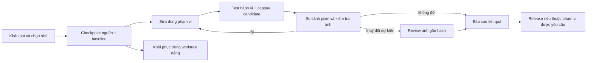

# T-RED WORLD — AI Development Skills

Bộ skill được xây cho **Canvas 2D tự viết + Vite + TypeScript/JavaScript + DOM/CSS**, giữ backend và dữ liệu hiện tại. Nghiên cứu engine, nguồn skill, script và quyền truy cập nằm tại [checkpoint khảo sát](docs/DEVELOPMENT_SKILLS_RESEARCH.md). Không cài Phaser/Spine/React hoặc generator gọi API ngoài để có thể dùng một skill.

## Skill và cách chọn

| Tác vụ | Skill chủ trì | Hỗ trợ / kiểm tra |
| --- | --- | --- |
| HUD, shop, menu, chữ, responsive mobile | `tred-game-ui` | Adapter Vercel `web-design-guidelines`, graphics/visual/browser |
| Pixel-art, crop, mũ/áo/kính/giày, item | `tred-asset-quality` | Pixel-art và sprite-pipeline đã pin; source/rig/asset gates |
| Tư thế nhân vật, xe, animation, layer | `tred-animation` | Solver Canvas hiện có, asset pipeline, 4 hướng × 2 base × các nhịp |
| Movement, camera, collision, interaction | `tred-gameplay` | Develop Web Game adapter, reachability, projection, touch và hai phiên |
| FPS, bộ nhớ, cache, DOM/Canvas, bundle | `tred-performance` | Đo trước/sau, allocation tests, bundle budgets và visual parity |
| Automated testing, screenshot, regression | `tred-visual-testing` | Browser fixtures, manifest ảnh, pixel diff, evidence/review |
| Phát triển web game nói chung | `develop-web-game` | Chu trình nhỏ implement→act→observe; dùng Playwright có sẵn |
| Cần tạo mới asset | `game-asset-gen` | Adapter quy trình; công cụ image generation sẵn có, seed/palette/candidate |
| Deployment được yêu cầu trong task | `tred-deployment` | Skill Vercel chính thức đã kết nối, exact commit/target/READY và HTTP evidence |

`tred-development` điều phối toàn bộ. Router đọc yêu cầu tiếng Việt/Anh và file liên quan, chọn **một owner**, thêm support đúng phạm vi và trả về các check cần chạy. Router chỉ lập kế hoạch, không thực thi lệnh người dùng nhập. Nhiều subsystem cùng bị ảnh hưởng thì support cung cấp kiểm tra, không mở các luồng refactor độc lập.

```sh
npm run skills:route -- --task "Nhân vật ngồi xe sai tư thế và lệch hướng" --files src/vehicle-rig.js
npm run skills:route -- --task "Sửa UI responsive mobile" --files src/quality.css
npm run skills:check
```

Ưu tiên: yêu cầu người dùng → AGENTS.md và adapter dự án → nguồn upstream đã nghiên cứu. Thứ tự hướng game giữ Front/down, Back/up, Left, Right. UI chữ/vector không nhận quy tắc palette/nearest của sprite. Sửa hình ảnh không được thay ví, collision hoặc protocol. Skill sinh ảnh chỉ dùng khi thực sự cần tạo/sửa art, không tự batch hay tìm API key.

Nguồn được pin trong `config/skill-sources.json`; instruction, routing và permission được khóa hash trong `config/development-skills.lock.json`. Khi thay đổi có chủ ý, đọc diff và script trước rồi chạy:

```sh
node scripts/check-development-skills.mjs --record-reviewed --reason "Mô tả cụ thể nội dung và quyền đã kiểm tra"
```

Đây là bước ghi nhận kiểm tra của kỹ sư/Codex, không phải yêu cầu người dùng phê duyệt mỗi chỉnh sửa. Registry là hướng dẫn/rào kiểm tra trong repo, không phải sandbox bảo mật của hệ điều hành. Không tải rules từ moving main, chạy remote installer hay cấp thêm quyền connector tự động.

## Quy trình và checkpoint



1. **C0 — khảo sát:** đọc git status/history, engine, nguồn tốt nhất và test liên quan. Lưu phạm vi, lỗi tồn tại và mục tiêu; không sửa chồng lên ảnh hỏng.
2. **C1 — trước sửa:** snapshot gồm file tracked, thay đổi chưa commit, file mới và file bị xóa; loại trừ DB, `.env*` (trừ template), `.vercel`, node_modules, dist và work. Capture baseline riêng. Có hash source runtime để tránh lấy nhầm ảnh trước sửa.
3. **C2 — sau sửa:** thực thi các check đã chọn, log riêng, capture candidate mới và so sánh. Không re-use thư mục output hoặc tự cập nhật baseline.
4. **C3 — kết quả:** mở ảnh thế giới/UI và gallery nhân vật/xe; đọc diff, log và metadata. Đổi hình dự kiến phải có lý do và danh sách ảnh đã xem, gắn với hash chính xác. Nếu thay đổi tiếp, review cũ hết hiệu lực.
5. **Thay đổi lớn:** đổi engine, thêm Spine runtime, đổi protocol/persistence hoặc refactor diện rộng cần báo cáo thiết kế và checkpoint trước; chưa được thực hiện trong đợt xây bộ skill này.

Ví dụ cho một lần sửa tiếp theo:

```sh
npm run dev:checkpoint -- create --label rider-fix --task "Sửa tư thế ngồi xe" --visual --output work/dev-checkpoints/rider-fix-v1
# Sửa source theo plan, giữ dữ liệu người chơi.
npm run skills:verify -- --checkpoint work/dev-checkpoints/rider-fix-v1 --task "Sửa tư thế ngồi xe" --output work/dev-verification/rider-fix-v1
```

`skills:verify` chỉ chạy allowlist lệnh kiểm tra; không shell-eval nội dung task. Build được chạy trước capture; các check khác lưu stdout/stderr vào output mới. Graphics test nhận đường output riêng, tránh ghi đè bằng chứng trước đó. Fixtures dùng SQLite tạm và loopback, không cần key hoặc DB production.

## Visual regression thực sự

`visual:capture` cố định Date, locale `vi-VN`, timezone, reduced motion và browser clock trong fixture. Nó tách UI/world và chụp **20 scenario**:

- Desktop 1440×1000 DPR 1, mobile 390×844 DPR 3, landscape 844×390 DPR 2: world, shop, fitting, profile, workspace.
- Gallery hai base × năm bộ đồ × bốn hướng.
- Bốn gallery nhịp 0/7/14/21, mỗi ảnh có đủ 12 xe × hai base × bốn hướng.

Đồng hồ/timer test không được đưa vào production hoặc protocol multiplayer. Test `test:graphics` bổ sung năm cấu hình viewport/DPR, bao gồm retina desktop, và chạm vào ghế đúng tọa độ ở DPR 3.

```sh
npm run visual:capture -- --output work/example/before
# Sau khi sửa:
npm run visual:capture -- --output work/example/after
npm run visual:compare -- --before work/example/before --after work/example/after --output work/example/comparison
```

Manifest ghi browser, font fingerprint, platform, DPR, source runtime, PNG dimensions/SHA-256 và bundle gzip. Khác môi trường render, thiếu ảnh, ảnh đổi kích thước, artifact bị sửa hoặc vượt budget → **blocked**. Thay đổi pixel → **review-required**, không có tự cập nhật baseline hoặc mask toàn bộ Canvas. Gallery actor/rider so sánh chính xác từng kênh (tolerance 0). Ảnh UI chỉ cho phép tối đa 16 pixel lệch không quá 1/255 mỗi kênh do nhiễu raster góc viền; cả raw delta và noise đều được ghi, không có mask. Vượt một trong hai giới hạn vẫn cần review. Chính sách này xuất phát từ hai pixel ±1 quan sát được khi chụp cùng source; không nới ngưỡng theo một asset hỏng. Độ đẹp/tư thế vẫn phải xem bằng mắt và đối chiếu semantic tests.

Mở `comparison.html` và PNG before/after/diff. Với thay đổi đúng chủ đích, Codex ghi nhận sau khi thực sự xem **tất cả ảnh thay đổi**:

```sh
npm run visual:review -- --report work/example/comparison/comparison.json --reason "Mô tả kết quả đã kiểm tra: thiết kế, tỷ lệ, anchor, layer và phần thay đổi dự kiến" --inspected actors.png
npm run visual:check -- --report work/example/comparison/comparison.json
```

Danh sách `--inspected` phải liệt kê đủ ảnh thay đổi thực tế, không chỉ ví dụ `actors.png`. Review không thể bỏ qua ảnh thiếu, môi trường sai, kích thước sai hoặc gameplay test hỏng. Không ghi đè review đã có; tạo comparison mới khi cần. Artifacts là bằng chứng có kiểm tra integrity, không phải cơ chế chống người có quyền tự sửa toàn bộ repository.

`npm run test:visual` chụp cùng source hai lần để kiểm tra độ ổn định của harness. Nó **không thay thế** đối chiếu baseline thực sự trước thay đổi. Không tuyên bố visual regression sạch chỉ nhờ hai ảnh sau sửa giống nhau.

## Rollback

```sh
npm run dev:checkpoint -- verify --checkpoint work/dev-checkpoints/rider-fix-v1
npm run dev:checkpoint -- restore --checkpoint work/dev-checkpoints/rider-fix-v1 --output work/skill-rollbacks/rider-fix-v1
```

Restore tạo detached Git worktree mới ở đúng commit rồi phục hồi snapshot dirty/untracked/deleted. Git hooks bị tắt cho lệnh tạo worktree này; không thay config toàn cục. Workspace đang làm việc, ví/inventory, DB và credentials giữ nguyên. Kiểm tra/build bản phục hồi trước khi quyết định dùng nó; tool không tự merge, push, rollback deployment hay restore dữ liệu production.

## Giới hạn và các vấn đề còn lại

- Baseline là mốc đối chiếu, không chứng minh asset cũ đã đẹp. 16 PNG master còn nợ strict alpha/palette; vẫn được báo rõ trong ASSET_QUALITY.md.
- `main.ts` và CSS override cần được xử lý theo các tác vụ riêng có số đo, không refactor trong đợt tooling này.
- Bundle budgets hiện là JS gzip 50 KiB, CSS gzip 12 KiB; có thể thay đổi sau một kiểm tra có lý do, không tự nới để qua test.
- Chưa đo FPS/pin trên điện thoại thật hoặc tải nhiều người đồng thời. Kết quả headless/viewport emulation không thay thế thiết bị thật.
- Chưa cài Git hook, workflow CI dịch vụ ngoài hoặc triển khai lại game trong đợt này. Gate repo chạy qua build và quy trình `skills:verify`; AGENTS.md yêu cầu Codex dùng nó khi đổi runtime/UI/asset.

Kết quả thực thi các checkpoint của đợt hiện tại được nối tiếp trong `progress.md` và `work/development-skills/20261101T032143Z/`.
